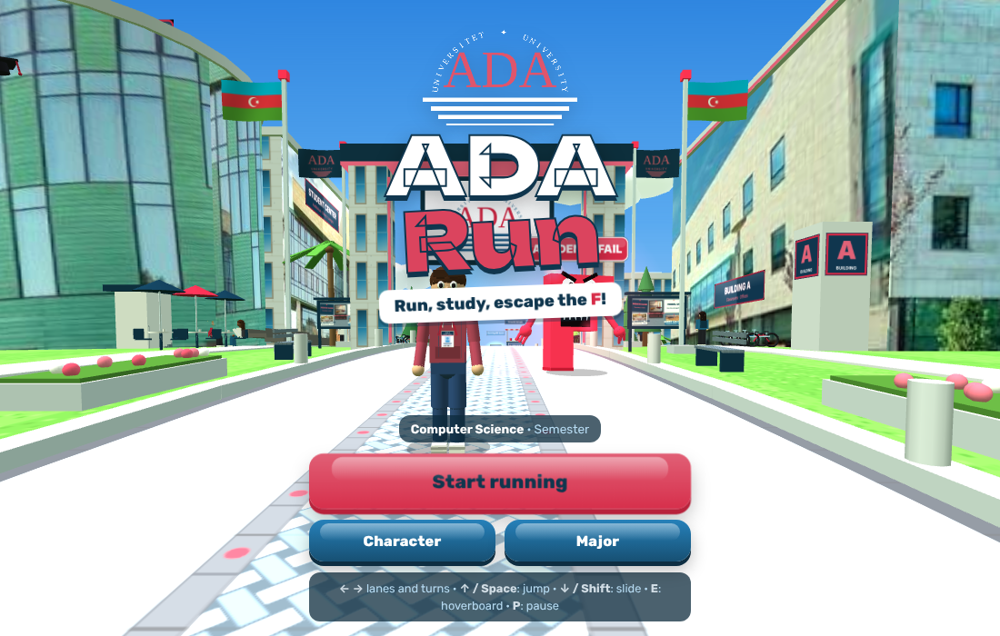
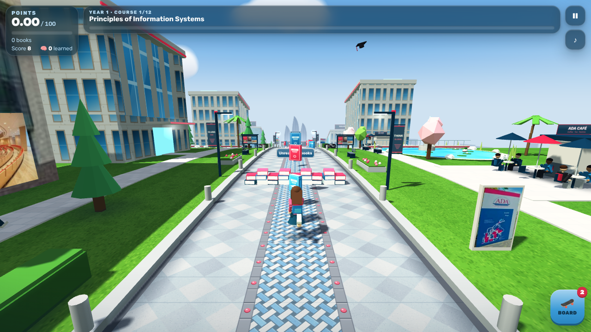
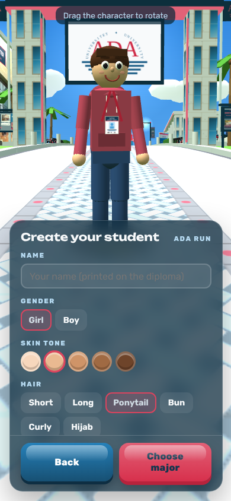
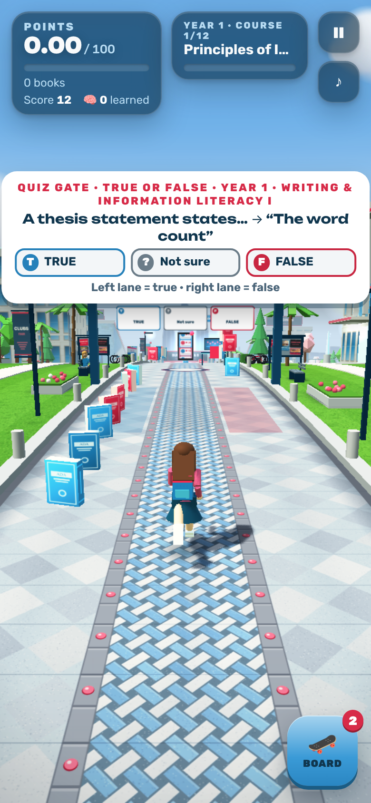

# ADA Run

**▶ Play now: https://hmaharramli55-dot.github.io/ADA-Run/**

An endless runner game in the style of Subway Surfers, set on the ADA University campus in Baku.

You play an ADA student running down a straight campus boulevard to escape a giant **F** (Academic Fail). Dodge exam barriers, unread textbooks, laptop desks and the distractions that make students fail, like TikTok, Instagram and parties. Collect books, answer quizzes from your own major and reach **100 points** to graduate.




<p>
  
  
</p>

## How to play

Open the link above, or open `index.html` in any modern browser on a computer or phone. Nothing needs to be installed.

| Action | Keyboard | Phone |
| --- | --- | --- |
| Change lane | ← → or A D | Swipe left / right |
| Jump | ↑, W or Space | Swipe up |
| Slide | ↓, S or Shift | Swipe down |
| Hoverboard | E | Double-tap |
| Pause | P or Esc | Pause button |

## Features

- **Student sign-in.** Enter your name, student ID or ADA email, major and academic year. There is no password: your profile, best score and progress are saved in your browser, and several students can share one device.
- **Quizzes for your major and year.** All 30 programmes from the ADA academic catalogue are included. A Year 3 student only gets Year 2 and Year 3 topics, never Year 4. Questions come in three formats:
  - checkpoint multiple choice
  - quick true/false
  - quiz gates, which you answer by running through the lane with the right answer

  Quizzes never show raw course codes.
- **Score and learning.** The HUD shows your score and how many topics you have learned (each right answer is one). Every run ends with a list of what you learned, and your profile keeps the total.
- **See other players and their scores.** Students playing at the same time appear on your track as see-through runners with their name and live score above their head, and a "Live race" box ranks everyone in the race. The start screen shows the top 3 students and your rank, the "All ADA" leaderboard lists everyone's best score, and every run ends with your ADA rank. Student IDs are never published.
- **Share.** The Share and Challenge friends buttons copy an invite message with the game link.
- **Real ADA campus.** The 3D world is built from photos and the real names of ADA buildings: Buildings A, B, D, E and L, the Library, the Student Center, the Caravanserai (School of Business), ADA Gardens and ADA School.
- **Academic obstacles.** The track has these obstacles:
  - exam barriers and piles of unread textbooks
  - laptop desks and giant backpacks
  - missed-deadline hurdles and procrastination banners
  - a swinging exam clock and a sliding pop quiz
- **Fair by design.** Obstacle patterns never block all three lanes with something you can't jump or slide past, and gaps grow as you speed up.
- **Your student.** Clearly different boy and girl models, with skin tone, hair, clothes and accessories.
- **Scoring.** One mode for everyone: 0.10 points per book, combos (x2, x3, x5) and pomegranate books worth 1.00. Power-ups include a hoverboard, jetpack, coffee magnet, focus mode and super-jump shoes. You get a transcript with GPA and, at 100 points, a diploma.
- **Look.** Caspian Blue, White and Pomegranate visual identity.

## Online play

The game connects players through a [Firebase Realtime Database](https://firebase.google.com/docs/database). Put the database URL in `FIREBASE_DB` near the top of the script in `index.html`:

```js
const FIREBASE_DB = 'https://ada-run-xxxxx-default-rtdb.europe-west1.firebasedatabase.app';
```

With the URL empty, the GitHub Pages version keeps scores on each device, and online play works on the game's claude.ai link instead.

## Built with

- HTML5, CSS and JavaScript in a single file
- [Three.js](https://threejs.org/) r128 (WebGL), loaded from a CDN
- Web Audio API for sound effects and music
- Firebase Realtime Database (REST and live streaming) for online play

## Author

Huseyn Maharramli, ADA University
